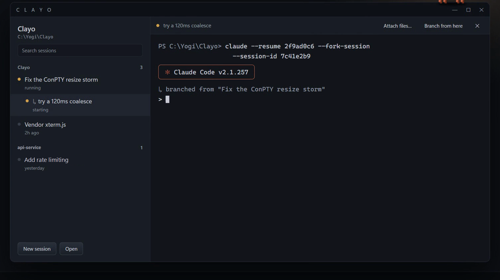
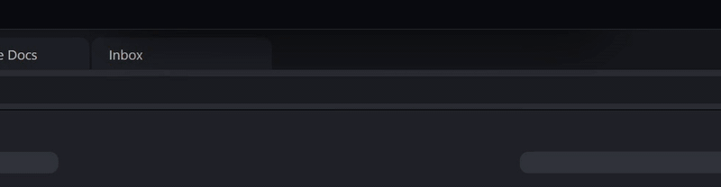

<div align="center">


# clayo-rust

**Every Claude Code and Codex session in one Windows window, plus an island that tells you which one needs you.**

A native Rust port of [Clayo](https://github.com/YogiOnCode/Clayo): same behaviour as Clayo 1.0.6,
without .NET or WebView2. One `clayo.exe`, no runtime to install.


</div>

## Why

You run four or five coding agent sessions at once, Claude Code or Codex, each in its own
terminal. One is waiting for a permission, one finished ten minutes ago, and you're in the
browser. Clayo puts them all in one window and tells you when one needs you, without you
switching windows. This port does the same in a fraction of the memory and start-up time.

## Rust port vs the original

| | clayo-rust | Clayo 1.0.6 (C#/WPF + WebView2) | Difference |
|---|---|---|---|
| Start → first frame | **0.15–0.18 s** | 1.0–1.4 s (8.8 s first start) | **5–10× faster** |
| RAM, idle with 1 session | **33 MB** | 223 MB (80 MB app + 144 MB WebView2) | **6.8× less** |
| RAM, 5 sessions | **48 MB** | 410 MB (65 MB app + 345 MB WebView2) | **8.6× less** |
| On disk | **one 18 MB exe** | 135 MB folder, 260 files | **7.4× smaller** |

Same laptop, release builds, throwaway config folders. Full numbers and how they were taken:
[`BENCH.md`](BENCH.md). What maps to what, and every behaviour checked off against the C# source:
[`PORTING.md`](PORTING.md).

## What you get



<sub>Screenshots are from Clayo 1.0.6; the port draws the same window.</sub>

- **The real Claude Code and Codex.** Each pane is a real terminal (ConPTY, drawn natively)
  running the `claude` or `codex` you already use: slash commands, permission prompts, plan
  mode, your status line.
- **Both side by side, or just one.** Use Claude Code, Codex or both; with both, each
  session in the sidebar is tagged **CC** or **CX**.
- **Set up in one screen.** The first time it starts, Clayo finds your agents, installs or
  signs in to the one you're missing, and turns on start at login and `clayo` in Explorer.
- **Sessions on the left, grouped by folder.** Search, rename (F2), resume with a click.
- **Branch from here.** Fork a conversation into a new session. The branch sits under its
  parent; the original stays as it was.
- **The island.** A small pill drops from the top of the screen when a session needs you or
  has finished, even while you're in another app. It never takes focus. Click it to jump to
  that session.

  

- **Drop a file or folder on the island** and it opens in Clayo.
- **Send a screenshot to a session.** Take one with Win+Shift+S, press **Ctrl+Alt+S**, and the
  island asks which session it's for. The image lands in that session's prompt. Settings ›
  Island can also offer it after every screenshot.
- **See the docs a session writes.** When a session writes a `.md` in its folder, a doc icon
  opens it rendered and follows its edits. HTML pages open in your browser.
- **Status at a glance.** Each pane's header shows model, branch and diff, context and
  effort. The sidebar footer shows your 5-hour and 7-day limits, drawn as Numbers, Bars,
  Rings or Chips, and the island warns you once when you get near one.
- **Type `clayo` in any Explorer address bar** to open a session in that folder.
- **Stays out of the way.** Start at login, hidden until the island has something to say.
  Closing the window keeps sessions running.
- **Updates itself.** When a new release is out, one click updates Clayo and opens it again,
  once no session is working.

## Install

Open PowerShell, paste this and press Enter:

```powershell
irm https://raw.githubusercontent.com/tkhangg0910/clayo-rust/main/scripts/install.ps1 | iex
```

It runs [scripts/install.ps1](scripts/install.ps1): it downloads the latest release, checks it
against the release's SHA-256, puts it in `%LOCALAPPDATA%\Programs\Clayo` and starts it. Every
release zip is built on GitHub Actions; to check one yourself, run
`gh attestation verify clayo-<version>-win-x64.zip --repo tkhangg0910/clayo-rust`.

<details>
<summary>Or by hand</summary>

1. Download `clayo-<version>-win-x64.zip` from the
   [latest release](https://github.com/tkhangg0910/clayo-rust/releases/latest).
2. Unzip it into `%LOCALAPPDATA%\Programs` (paste that into Explorer's address bar), so you
   have `%LOCALAPPDATA%\Programs\Clayo\clayo.exe`. Keep it there: start at login and `clayo`
   in Explorer point at this folder.
3. Run `clayo.exe`. It isn't signed yet, so Windows may say "Windows protected your PC":
   click **More info**, then **Run anyway**.

</details>

You need Windows 10 or 11, 64-bit, and nothing else: no .NET, no WebView2.

### First run

The setup window looks for [Claude Code](https://docs.claude.com/en/docs/claude-code) and
[Codex](https://github.com/openai/codex). You need at least one.

- Missing one? **Install** runs its own installer in a PowerShell window you can watch
  (Codex needs [Node.js](https://nodejs.org) first). **Sign in** does the same for signing
  in, and **Locate…** points Clayo at an install in an unusual folder.
- Choose which ones to use and which one **New session** starts.
- Keep **Start Clayo when I sign in** and **Add clayo to my PATH** ticked, then press
  **Open Clayo**.

**Settings › Agents** brings the setup window back. What works with each agent, and how to
install them by hand: [docs/AGENTS.md](docs/AGENTS.md).

### Moving from the C# build

Quit the C# Clayo from its gear menu, then install this one into the same folder. Your settings
(`%LOCALAPPDATA%\Clayo\settings.json`), custom session names, branch links and screenshots are read
as they are. The two builds share the single-instance lock, so they never run side by side.

### Updating

When a new release is out, an **Update to …** button shows above **New session**. Press it:
Clayo closes, updates and opens again. A session that is working or asking you something is
never cut off: the update waits until none is. Clayo asks GitHub for the latest release when it
starts and every 12 hours after.

Or quit Clayo from the gear menu and run the install command again. Either way your settings
are kept.

### Uninstalling

1. In **Settings › Agents**, untick **Start Clayo when I sign in** and **Add clayo to my
   PATH**, and press **Open Clayo**.
2. **Quit Clayo** from the gear menu.
3. Delete `%LOCALAPPDATA%\Programs\Clayo`, and `%LOCALAPPDATA%\Clayo` too if you want your
   settings gone. Your Claude Code and Codex sessions aren't touched.

### Build from source

You need Rust stable (1.85+) with the MSVC toolchain and the Visual Studio C++ build tools.

```powershell
git clone https://github.com/tkhangg0910/clayo-rust.git
cd clayo-rust
cargo build --release          # target\release\clayo.exe
```

`cargo test` runs the checks (the C# `checks/*.cs`, ported; ~430 tests) and
`cargo clippy --all-targets -- -D warnings` the lints. `.\scripts\publish.ps1` builds the
release zip. A fork that publishes its own releases builds with
`$env:CLAYO_UPDATE_REPO = "<owner>/<repo>"` and points `scripts/install.ps1` at it.

| Crate | What it is |
|---|---|
| `clayo-core` | All logic with no UI: transcripts, sessions, status relay and store, settings, rules, island state machine, setup texts, login start, PATH, updater. |
| `clayo-pty` | ConPTY: spawn, read thread, write, resize, non-blocking teardown. |
| `clayo-term` | VT parsing (`alacritty_terminal`), colours, key/mouse encoding, the egui terminal widget. |
| `clayo-island` | The island: a layered Win32 window that never takes focus, glow, mascot, screenshot picker, drop target. |
| `clayo-app` | `clayo.exe`: eframe/egui (OpenGL, Direct3D 12 fallback) main window, setup window, Settings. |
| `bench` | `clayo-bench` and the scripts behind BENCH.md (not part of clayo.exe). |

## Use

- **New session**: the button at the bottom of the sidebar, or `clayo` in a folder.
- **Branch**: open a session, then **Branch from here** in its header.
- **Settings**: the gear menu, or `Ctrl+,`. **Agents** there reopens the setup window.
- **Quit**: **Quit Clayo** in the gear menu or the island's menu. The window's close button
  only hides it.

## Docs

| | |
|---|---|
| [Claude Code and Codex](docs/AGENTS.md) | What works with each, installing them by hand |
| [PORTING.md](PORTING.md) | How the C# app maps to the Rust crates, and every behaviour checked |
| [BENCH.md](BENCH.md) | Start-up, memory, CPU, latency and size, measured against C# 1.0.6 |
| [Clayo wiki](https://github.com/YogiOnCode/Clayo/wiki) | The original app's guides; the port behaves the same |

## Differences from the C# build

Agreed in PORTING.md §6: HTML pages a session writes open in your browser instead of beside the
terminal (D3); Markdown docs show no remote images (D4); emoji are monochrome (D7); "Also apply to
Codex" is read-only, because Clayo does not write into `~/.codex` (D1); the terminal cursor stops
blinking after 5 s of quiet (D14).

## Contributing

Issues and pull requests are welcome. Open an issue before a big change so we can agree on
the approach first. For debugging, `clayo.exe` reads `CLAYO_STARTUP_LOG`, `CLAYO_FRAME_LOG`,
`CLAYO_BENCH_TYPE`, `CLAYO_BENCH_AGENT_CMD`, and in debug builds `CLAYO_PTY_LOG`,
`CLAYO_DEV_AGENT_CMD`, `CLAYO_DEV_SETTINGS`, `CLAYO_DEV_RENDERER`. Point `CLAUDE_CONFIG_DIR`,
`CODEX_HOME` and `LOCALAPPDATA` at temp folders to try a build without touching your real setup.

## Notes

Clayo was created by **Yogeswaran Amsavalli** ([YogiOnCode/Clayo](https://github.com/YogiOnCode/Clayo)).
The design, behaviour, texts, mascot and island are the original author's; the Rust code
reimplements them. The port is by [tkhangg0910](https://github.com/tkhangg0910); this repository
keeps the full git history of the original C# project, so every original commit stays attributed
to its author. Not affiliated with Anthropic or OpenAI.

Clayo reads `~/.claude` and `~/.codex` and never writes to either
(`clayo-core/tests/invariants.rs`). It writes its own files in `%LOCALAPPDATA%\Clayo` only, plus
the `HKCU\...\Run` value `Clayo` and the user `Path` from the setup window. Its only network call
is asking GitHub for the latest release.

MIT licensed, see [LICENSE](LICENSE) (original author first, then the Rust port). Third-party
crates and the embedded Chart.js / Mermaid files are listed in
[THIRD_PARTY_NOTICES.md](THIRD_PARTY_NOTICES.md). Citation metadata: [CITATION.cff](CITATION.cff).
